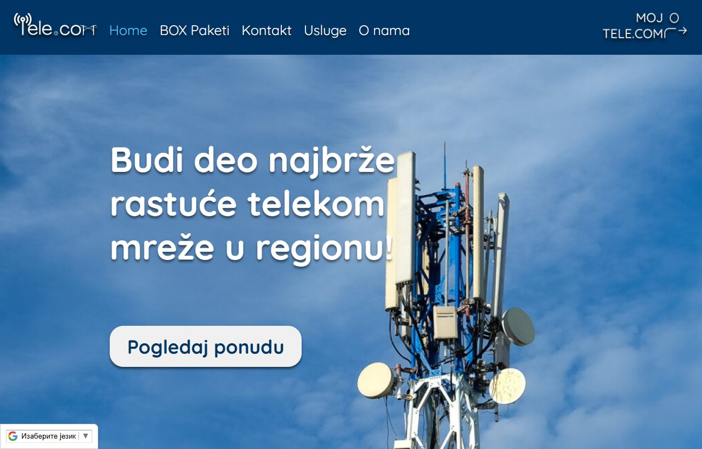
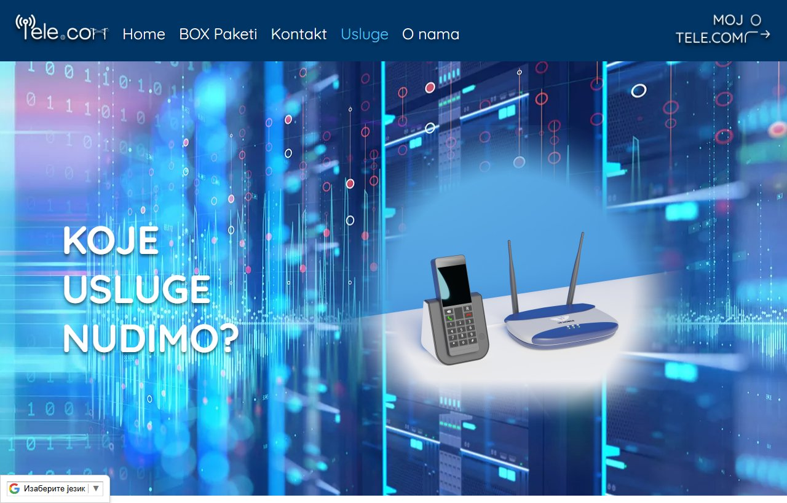

# Tele.com

**University Web Design project · HTML, CSS and JavaScript**

A multi-page telecom website prototype with service pages, package browsing, contact screens, and browser-side account views.

[Open the GitHub Pages site ↗](https://indzo.github.io/tele.com/)



## What the source shows

- Static HTML pages for the homepage, services, packages, contact and account views.
- Page-specific CSS and JavaScript for navigation, rendering service information and prototype interactions.
- A client-side account prototype and historical sample data. Use the public site to explore the design. Do not enter real account or contact information.

## Run locally

From the repository root, run:

```bash
python -m http.server 8080 --bind 127.0.0.1
```

Open [http://localhost:8080](http://localhost:8080). Using a local HTTP server lets the browser load static JSON and other assets. Some historical prototype interactions reference an external service, so the static server alone does not provide a working account backend.



This was an early independent web-development project. The repository preserves the original browser code and design.
